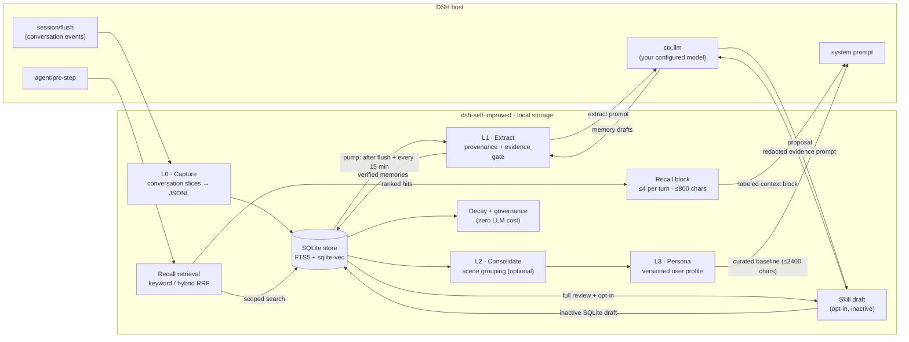
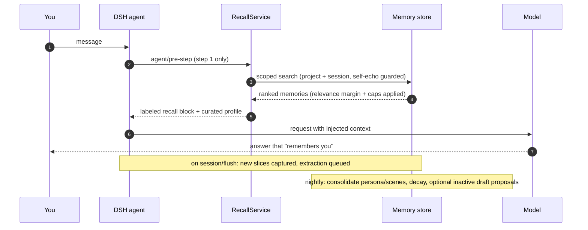

# dsh-self-improved

**Long-term memory and session continuity for DeepSeek Harness.**

  

A plugin for **DeepSeek Harness (DSH)** that remembers what you teach it across sessions, recalls the relevant bits before each reply, and offers to pick up unfinished work from an earlier session. Everything is stored locally (SQLite + JSONL). Memory extraction uses your configured model; handoff summaries and learning from tool use send data to it only after you turn them on.

## Install

Requires **DeepSeek Harness 0.2.1 or newer** and Node.js 22.16+.

```bash
dsh plugin --profile web add @asheghi/dsh-self-improved
```

Then restart DSH (`dsh web`). Use your own profile name instead of `web` if you run a different one (`tui`, `desktop`, …). Installing registers the plugin with the profile automatically; there is no config file to edit.

Open **Settings → Evolving Memory**. Memory capture, extraction and recall are on by default. Session continuity and learning from tool use are off until you turn them on there. With continuity on, stopping partway through a task makes a banner appear above the message box of your other chats in that project; it fills the message box for you to review and send, and never sends anything itself.

| Task | Command |
|---|---|
| Upgrade | `dsh plugin --profile web update @asheghi/dsh-self-improved` |
| Remove | `dsh plugin --profile web remove @asheghi/dsh-self-improved` (your memories stay in `$DSH_HOME/memory`) |

| DSH version | Plugin |
|---|---|
| 0.2.1 and newer | `@asheghi/dsh-self-improved` 0.2.x (this branch) |
| 0.1.x | the [`v0.1` branch](https://github.com/asheghi/dsh-self-improved/tree/v0.1) |

Having trouble? See [TROUBLESHOOTING.md](./TROUBLESHOOTING.md).

## Why would I need this?

Without it, every new DSH session starts blank:

- **You repeat yourself.** Stack, server, conventions, preferences: re-explained every session.
- **Good decisions evaporate.** The agent re-litigates settled questions and re-makes settled mistakes.
- **No persona builds up.**

With it, the agent walks in already knowing what you taught it before; reviewed procedures can become inspectable inactive skill drafts (opt-in, never auto-activated).

## What you get

| Capability | What it does | Where it shows up |
|---|---|---|
| **Cross-session memory** | Distills facts / preferences / events into durable memories | Injected before each turn |
| **Session continuity** (opt-in) | Notices work you stopped partway and offers it to your next chat in the same project | A banner above the message box: Review, then *Use in message* |
| **Relevant recall** | Only memories matching the current question, scoped to project and session | Labeled block in context; generic prompts inject nothing |
| **Evolving persona** | Strongest confirmed memories become a versioned profile | Curated baseline in the system prompt |
| **Skill proposals** | Repeated reviewed procedures become inspectable inactive drafts | SQLite, project-scoped; opt-in, never auto-published |
| **Self-maintenance** | Decay and growth caps, zero LLM cost | Every maintenance round |
| **History search** | Full-text search over memories and past conversations | `memory_search` / `conversation_search` tools |
| **Your control** | Edit or forget any memory instantly | `/memory` + Settings → Evolving Memory |

## How it works

Hangs off DSH's native extension points (`session/flush`, `agent/pre-step`, `systemPrompt`, `ctx.llm`, and settings namespaces). Four-layer pipeline (L0 capture → L1 extraction → L2 consolidation → L3 persona), inspired by [TencentDB Agent Memory](https://github.com/TencentCloud/TencentDB-Agent-Memory):



1. **Capture**: session flush events persist as JSONL slices tagged with project scope; delegated sessions are never treated as your statements.
2. **Extract**: an LLM pass distills pending slices into memories that pass the strict gate (direct-human provenance, verbatim evidence, not task-local), JSON-validated and deduplicated.
3. **Consolidate**: the nightly review builds scenes (optional) and a versioned persona from your strongest confirmed memories.
4. **Recall**: before each turn, keyword/hybrid retrieval (RRF, optional embeddings) renders matching memories as a labeled, fallible block; the curated profile renders in the system prompt.
5. **Maintain**: decay retires stale memories; caps bound growth; optional reviewed procedures become inactive SQLite skill drafts (not `dsh-skill` publications).

### A turn, end to end



### When things run

| Trigger | What runs | LLM cost |
|---|---|---|
| Every turn (session flush) | capture slices, queue extraction | 0 |
| Right after flush + every 15 min | extraction pump, decay, governance caps | one small call, when new content exists |
| Nightly (default **22:00**), ~60s after boot, or `/memory evolve` | full review: drain extraction + consolidation + optional episode review and inactive skill-draft generation + decay/governance | moderate |
| Before each model call | recall retrieval + injection | 0 (keyword) / one embedding call (hybrid) |
| `/memory` commands, memory browser | local store queries only | 0 |

## Memory policy

High-signal by default (Hermes-conservative). A memory becomes durable only if it comes from direct human input (assistant prose, tool output, and injected text are filtered out), carries a verbatim evidence quote, and is not task or session local.

Recall = a small curated baseline (pinned, human-corroborated profile facts, in the system prompt) + contextual recall: only memories matching the current question, capped by relevance margin, importance floor, and 4 blocks per turn.

Nothing is deleted silently: upgrading an existing store quarantines pre-upgrade rows (`provenance=unknown`) until you confirm them (`accept-legacy`). Corrections via `/memory correct` or the browser's Correct action apply immediately and mark the memory human-confirmed; the `memory_correct` tool only stages a candidate until you confirm it.

### Episode learning (opt-in, off by default)

With `episodeLearning.enabled`, the plugin records tool calls and results per session ("episodes"): arguments/results are redacted and bounded at capture time, paired strictly by call id, and classified deterministically (ambiguous/interrupted histories are never learned from). A separate LLM review pass (manual or nightly only) distills evidence-cited, project-scoped *operational* memories that expire (90 days) and never touch persona, baseline, or user memories; with `operationalRecallEnabled` they inject in a separately labeled, capped block. The separate `skillDraftsEnabled` option (default off) can send reviewed, redacted evidence to the configured model during full review and store project-scoped, cited skill proposals in SQLite. Drafts require independent direct sessions and remain inactive: no `dsh-skill` file is written or loaded. Inspect drafts with `/memory skill-drafts` and `/memory skill-draft <id> [--full]`; these commands require episode consent and show only the receiving session's project. Every purge invalidates dependent drafts; explicit user-triggered purge also forgets linked episode-review-derived memories (user-authored memories remain), while scheduled retention keeps its non-cascading policy. Episode controls also include dry-review, purge, and forget under `/memory episodes …`; episode rows auto-expire after `retentionDays`.

## Privacy

- Store: `$DSH_HOME/memory` (configurable). The plugin itself calls no network services; model and embedding traffic follows your DSH configuration.
- Master switch off = dormant: extraction, recall, the `/memory` command, and memory tools stop; memories are kept and everything resumes when re-enabled.
- Episode learning is a separate opt-in layer with its own switch and consent prompt on first enable; captured tool arguments/results are redacted before persistence. Enabling outcome review or inactive skill drafts sends that redacted evidence to the configured provider; drafts remain local and inactive.

## Development

```bash
git clone https://github.com/asheghi/dsh-self-improved && cd dsh-self-improved
pnpm install
DSH_RUNTIME_RC2=/path/to/a/dsh-0.2.1-install pnpm build   # strict typecheck + emit lib/
npm pack                                                  # → asheghi-dsh-self-improved-<version>.tgz
dsh plugin --profile web add ./asheghi-dsh-self-improved-<version>.tgz
```

`DSH_RUNTIME_RC2` points at a directory where `@deepseek-ai/dsh` 0.2.1 is installed (`npm i @deepseek-ai/dsh@0.2.1-rc.2`); the build validates the plugin against those exact packages. The history of the 0.2 port lives in [migration/README.md](./migration/README.md).

### Build modes

```bash
pnpm build          # strict typecheck against the pinned DSH peers (+ --emit-lib)
node scripts/test-v02-package.mjs   # package-artifact gate (pack file list, offline runtime harness, prepare lifecycle)
node scripts/test-v02-typecheck-modes.mjs   # staged-artifact mode regressions (strict vs artifact verification)
```

- Peer source resolution: repo `node_modules/@deepseek-ai` first (must match the
  exact versions package.json pins); else the documented coordination test site
  (read-only); `DSH_RUNTIME_RC2=<tree>` overrides explicitly and fails closed if
  invalid; legacy rc.6/rc.8 peers are never silently used. `DSH_V02_NO_TEST_SITE=1`
  disables the site fallback for self-sufficient builds.
- Modes are never conflated: `build` / `typecheck:v02` / no-flags are the strict
  rc.2 gate and fail closed (exit 2) without a TypeScript toolchain — a shipped
  prebuilt `lib/` is never accepted as strict evidence. The only no-compiler
  path is explicit `--allow-prebuilt` (kept on the manifest's `prepare` for the
  consumer-install context): it verifies the shipped lib/entry points/dsh bundle
  patch, prints an explicit "no strict compile" notice, emits nothing, and
  refuses an explicitly invalid `DSH_RUNTIME_RC2`, an empty or
  non-exactly-pinable @deepseek-ai peer set, and any incomplete artifact.
- Package-gate results: [fixtures/v02-package/](./fixtures/v02-package/),
  [fixtures/v02-typecheck-modes/](./fixtures/v02-typecheck-modes/) and
  [MIGRATION-PACKAGE-REVIEW.md](./migration/MIGRATION-PACKAGE-REVIEW.md).

## Operations

### Dry-run migration (`scripts/migrate-hermes.mjs`)

```bash
pnpm run migrate:hermes -- --dir ~/.dsh/memory --dry-run      # analysis only, source db untouched
pnpm run migrate:hermes -- --dir ~/.dsh/memory --no-dry-run   # real run; a pre-hermes store is backed up to memory.db.pre-hermes.bak first
```

Dry-run first. The real run never deletes anything (rows collapse to `supersedes` links; summary in `memory/migration-log/`). A pre-hermes store is backed up to `memory.db.pre-hermes.bak` before any schema change (kept if a backup already exists); that backup is the rollback point.

### Generated-skill audit (dry-run by default)

```bash
pnpm run skills:audit -- --root ~/.dsh/skills            # dry run (default)
pnpm run skills:audit -- --root ~/.dsh/skills --apply    # archive redundant skills
```

Audits `dsi-*` skills for duplicates and high body overlap; `--apply` moves redundant ones into `<root>/.dsi-archive/<timestamp>/`, never deletes, and fixes retained skills whose frontmatter name disagrees with their directory. Idempotent; only `dsi-*` directories with `SKILL.md` are classified.

## Configuration

Everything is editable in **Settings → Evolving Memory**. Saved values land in your profile's `cordis.patch.yml` (`$DSH_HOME/profiles/<profile>/cordis.patch.yml`) under the plugin's entry, so you can also edit them there:

```yaml
- id: dsh-self-improved
  config:
    continuity:
      enabled: true          # track unfinished work
      summaryEnabled: false  # write handoff notes with the model (sends excerpts to your provider)
    review:
      enabled: true          # nightly review (one full evolution per day)
      time: "22:00"          # HH:MM, 24h
```

- Conservative defaults are settings, not hardcode; editable fields appear in the settings UI ("Evolving Memory" → Settings): `extract.provenanceFilter: "strict"`, `extract.requireEvidence: true`, `recall.relevanceMargin: 0.5`, `recall.minImportance: 0`, `recall.maxInjectPerTurn: 4`, `consolidate.scenesEnabled: false`, `episodeLearning.skillDraftsEnabled: false`. The legacy `evolve.skillSynthesis.enabled` field no longer publishes active skills.
- Read-only `/memory` commands are zero-LLM; `/memory evolve` and episode review can call the configured provider when enabled.

## Repository layout

| Path | What it is |
|---|---|
| `src/*.ts` | TypeScript sources: the plugin's server side |
| `lib/` | Compiled output (`tsc`); what npm ships |
| `client.js` | Web UI half: "Evolving Memory" settings + memory browser (no build step) |
| `scripts/` | Ops scripts and test runners |
| `cordis.patch.yml` | Bundle mount declaration (auto-applied via `dsh.bundle`) |

Tests: `pnpm run test:all`; runners in `scripts/test-*.mjs`.

## Compliance and acknowledgements

- Forked from [madage/dsh-self-improved](https://github.com/madage/dsh-self-improved), published on npm as `dsh-self-improved` for DSH 0.1; this fork carries the DSH 0.2 port and is published as `@asheghi/dsh-self-improved`.

- Architecture inspired by [TencentDB Agent Memory](https://github.com/TencentCloud/TencentDB-Agent-Memory) (Tencent Cloud): the four-layer memory pyramid is the direct inspiration for this pipeline; independent implementation, no affiliation with Tencent.
- Self-evolution design inspired by [self-improving-agent](https://github.com/pskoett/self-improving-agent) (pskoett).

## Docs

- `README.md`: this file
- `ROADMAP.md`: milestones and plan history (repository only)
- `TROUBLESHOOTING.md`: install pitfalls and fixes
- `migration/README.md`: v0.2 migration status and per-phase evidence records
- `docs/` (design docs, testing guide, DSH research): local only, excluded via `.gitignore`

## License

MIT License. See [LICENSE](./LICENSE) for the full text.

Copyright (c) 2026 mashao.
